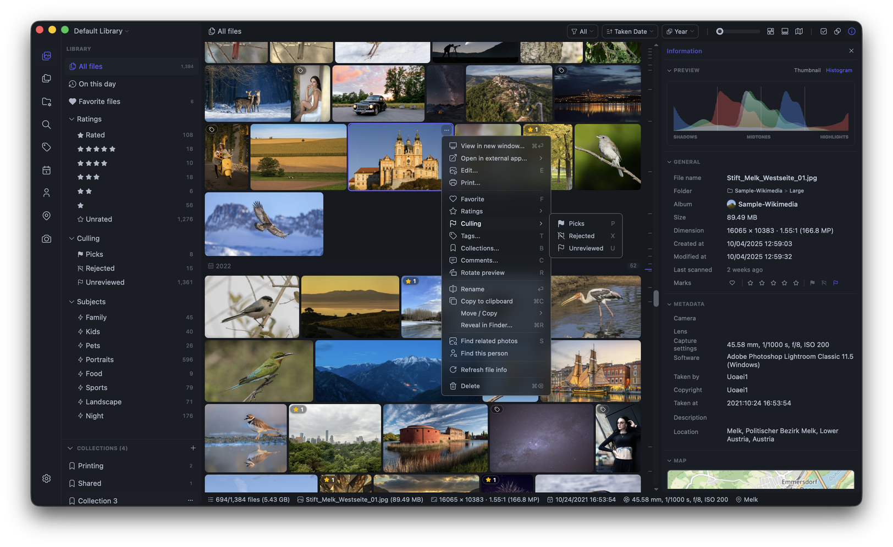
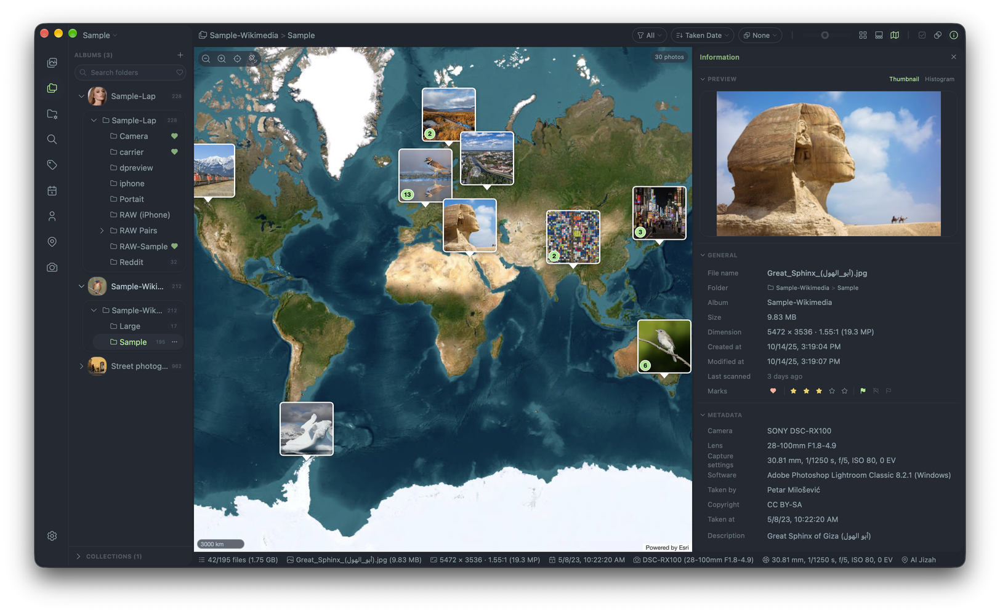
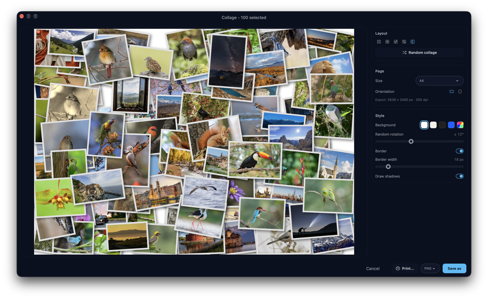

<div align="center">
  
  <h1>Lap - 私人本機相片管理器</h1>
  <h3>適用於 macOS、Windows 與 Linux 的開放原始碼桌面相片管理軟體。</h3>
  <p>
    <a href="https://github.com/julyx10/lap/releases"></a>
    <a href="https://github.com/julyx10/lap/releases"></a>
    <a href="https://github.com/julyx10/lap/stargazers"></a>
  </p>
</div>

[English](../README.md) | [Deutsch](README.de.md) | [Español](README.es.md) | [Français](README.fr.md) | [Italiano](README.it.md) | [Magyar](README.hu.md) | [Nederlands](README.nl.md) | [Polski](README.pl.md) | [Português](README.pt.md) | [Русский](README.ru.md) | [Українська](README.uk.md) | [中文简体](README.zh-CN.md) | 中文繁體 | [日本語](README.ja.md) | [한국어](README.ko.md)

Lap 是一款開放原始碼、以本機為先的相片管理器，讓您輕鬆瀏覽家庭相簿、快速找出老照片，並離線管理大型個人媒體資料庫。
它是雲端相片服務的隱私替代方案：不強制上傳、內建本機 AI 搜尋、以資料夾為中心的工作流程，且完全免費使用。

## 下載 Lap

開啟 [最新版本發布頁面](https://github.com/julyx10/lap/releases/latest)，下載符合您系統的檔案：

| 平台 | 安裝包 | 備註 |
| :-- | :-- | :-- |
| **macOS (Apple Silicon / Intel)** | `_aarch64.dmg` / `_x64.dmg` | 已通過 Apple 公證 |
| **Windows 10/11 (x64 / ARM64)** | `_x64_en-US.msi` / `_arm64_en-US.msi` | 未簽章 — 若 SmartScreen 阻擋下載，請點擊**仍要保留** |
| **Linux (x64 / ARM64)** | `_amd64.deb` / `_arm64.deb` | 適用於 Debian 系列發行版（Ubuntu、Debian、Linux Mint 等） |
| **Linux (x64 / ARM64)** | `_amd64.AppImage` / `_aarch64.AppImage` | 授予檔案可執行權限後，雙擊執行 |

### 使用 Homebrew 安裝 macOS 版

```bash
brew tap julyx10/lap
brew install --cask lap
```

## 螢幕截圖

<p align="center">
  
  
  
</p>

## 為什麼選擇 Lap

- **本機優先設計**：您的相片保存在自己的硬碟上，不需要雲端帳號或強制上傳。
- **不鎖定資料庫**：直接使用現有的資料夾，無需將所有內容匯入封閉式資料庫。
- **隱私的 AI 工具**：搜尋、相似照片、智慧標籤與人臉辨識功能皆在本機執行。
- **為大型資料庫打造**：針對超過 10 萬個檔案的資料庫最佳化，瀏覽與整理依然順暢。
- **開放原始碼且免費**：無訂閱、無生態系綁定，程式碼可自行檢視。

## 功能特色

- **彈性瀏覽資料庫**：依日期、資料夾、地點、相機、鏡頭、標籤、評分與人臉篩選，支援排序與搜尋。
- **以資料夾為中心的工作流程**：支援多個資料庫、拖曳匯入/匯出、剪貼簿匯入/匯出、檔案系統同步，以及安全的移動、複製與刪除操作。
- **本機 AI 搜尋**：支援文字搜尋、視覺相似搜尋、主題、人臉分群，以及可選的 50 多種語言搜尋。
- **智慧相簿**：儲存基於規則的檢視，可自訂分組與排序。
- **依日期整理的匯入方式**：支援按日、月、年或單一資料夾匯入，保留原檔名並跳過重複項目。
- **收藏與標籤**：批次整理所選檔案，無需移動或複製原始檔案。
- **重複照片清理**：顯示可釋出的空間，並可跨重複群組批次清理。
- **選片與比較工具**：包含四窗格圖片比較檢視器。
- **內建編輯**：支援裁剪、任意角度拉直、旋轉、翻轉、縮放與基本影像調整。
- **相片拼貼**：將所選相片排成格狀、馬賽克或相片堆疊，合成一張拼貼。
- **Apple 原況相片與 Google 動態相片**：支援動態播放，並可透過統一的智慧相簿條件篩選。
- **RAW + JPEG/HEIC 配對**：以單一項目顯示，進行檔案操作時同步處理相關聯檔案。
- **可設定的 RAW 縮圖與預覽**：可使用 RAW 算繪或相機內嵌預覽，並支援調整亮度與 RAW+JPEG 配對顯示。
- **互動式地圖檢視**：以叢集方式瀏覽含地理資訊的相片與影片，並遵循目前的篩選條件。
- **離線相簿瀏覽**：未連接或網路儲存上的相簿仍會顯示，並保留快取的縮圖。
- **廣泛的格式支援**：支援 60 多種相片、RAW 與影片格式。

## 中繼資料、收藏與檔案移動

Lap 以資料夾為中心，但 Lap 中顯示的資訊並非全都內嵌在原始檔案中。若您同時也會在 Finder、Explorer 或其他相片應用程式中管理同一批資料夾，理解這項差異就十分重要。

### 會隨檔案保留的資訊

- 您的原始相片與影片始終是現有資料夾中的普通檔案。
- 已內嵌在檔案中的中繼資料，例如 EXIF 拍攝日期、相機、鏡頭、GPS 與方向，會在 Lap 建立索引時從該檔案中讀取。
- 儲存內建圖片編輯時，產生的圖片會寫入所選的目標位置。
- 當您**在 Lap 中**重新命名、移動、複製或刪除檔案時，Lap 會同時更新其本機目錄。支援的群組資源，例如 Apple 原況相片元件、AAE 附屬檔案與已啟用的 RAW + JPEG/HEIC 配對，都會一併維持在一起。

### Lap 在本機儲存的資訊

以下項目屬於 Lap 的資料庫資料，儲存於 Lap 的本機資料庫或資料庫設定中，不會寫入 EXIF、IPTC 或 XMP 附屬檔案：

- 收藏、標籤、註解、我的最愛、評分與選片狀態（包含已選與已排除）
- 智慧相簿及其規則、分組、排序與順序
- AI 搜尋資料、人臉資料、縮圖，以及其他索引或快取資料

當檔案在 Lap 之外被複製、匯出或移動時，這些資料不會隨檔案一起傳遞，也不會自動提供給其他應用程式。

### 在 Lap 之外管理檔案

Lap 可以重新掃描資料夾並偵測許多檔案系統變更。但若在 Lap 之外進行重新命名、移動、取代或複製檔案等操作，可能會影響僅儲存於 Lap 中的整理資訊。

若需要最可靠的結果，只要您使用收藏、標籤、註解、我的最愛、評分或選片狀態，請盡量在 Lap 中進行檔案的重新命名與移動。若您也在 Lap 之外管理檔案，請將 Lap 的資料庫與設定連同相片一起備份。您可以在 **設定 → 儲存空間** 中管理資料庫位置並建立備份。

刪除 Lap 的資料庫或設定檔會移除這些本機整理與索引資料，但不會刪除您的原始媒體檔案。

## 解除安裝 Lap

Lap 直接使用您現有的相片資料夾。解除安裝 Lap，或刪除其資料庫與快取檔案，**不會**刪除您的原始相片。

標準的解除安裝步驟會移除應用程式。若要完全移除 Lap，請先結束 Lap，解除安裝應用程式，然後依照您平台的清理指令，刪除其本機資料庫、縮圖快取與設定檔。

### macOS

若您使用 Homebrew 安裝 Lap：

```bash
brew uninstall --cask lap
```

若您手動安裝，請結束 Lap，並將 `Applications` 資料夾中的 `Lap.app` 移到垃圾桶。

若要移除所有 Lap 資料庫、快取與設定檔：

```bash
rm -rf "$HOME/Library/Application Support/com.julyx10.lap" \
       "$HOME/Library/Caches/com.julyx10.lap" \
       "$HOME/Library/WebKit/com.julyx10.lap"
rm -f "$HOME/Library/Preferences/com.julyx10.lap.plist"
```

### Windows

開啟 **設定 > 應用程式 > 已安裝的應用程式**，找到 **Lap**，然後選擇 **解除安裝**。

接著開啟 PowerShell，並移除所有 Lap 資料庫、快取與設定檔：

```powershell
Remove-Item -Recurse -Force -ErrorAction SilentlyContinue "$env:LOCALAPPDATA\com.julyx10.lap"
Remove-Item -Recurse -Force -ErrorAction SilentlyContinue "$env:APPDATA\com.julyx10.lap"
```

### Linux

對於 DEB 安裝方式，請解除安裝套件：

```bash
sudo apt remove lap
```

對於 AppImage 安裝方式，請結束 Lap，並刪除下載的 `.AppImage` 檔案。

接著移除所有 Lap 資料庫、快取與設定檔：

```bash
rm -rf "$HOME/.local/share/com.julyx10.lap" \
       "$HOME/.cache/com.julyx10.lap" \
       "$HOME/.config/com.julyx10.lap"
```

若您曾在 Lap 設定中選擇自訂的資料庫儲存目錄，請先確認其中僅包含 Lap 資料庫檔案，再單獨刪除該目錄。

## 從原始碼建置

需求：Node.js 20+、pnpm、Rust stable。

```bash
# macOS 系統相依套件
xcode-select --install
brew install nasm pkg-config autoconf automake libtool cmake

# Linux 系統相依套件
# sudo apt install libwebkit2gtk-4.1-dev libappindicator3-dev librsvg2-dev \
#   patchelf nasm clang pkg-config autoconf automake libtool cmake

# 複製並建置
git clone --recursive https://github.com/julyx10/lap.git
cd lap
git submodule update --init --recursive
cargo install tauri-cli --version "^2.0.0" --locked
./scripts/download_models.sh            # Windows: .\scripts\download_models.ps1
./scripts/download_ffmpeg_sidecar.sh    # Windows: .\scripts\download_ffmpeg_sidecar.ps1
cd src-vite && pnpm install && cd ..
cargo tauri dev
```

發行版套件可以連結系統的 libheif（1.17 或更新版本），取代內建的 libheif 與 libde265。建置時請設定 `LAP_SYSTEM_LIBHEIF=1`。此時不再需要 `third_party/libheif` 與 `third_party/libde265` 這兩個子模組。HEVC 解碼取決於系統 libheif 的編解碼器外掛程式。

## 支援的格式

Lap 支援 60 多種相片、RAW 與影片格式。

| 類型 | 格式 |
| :--- | :--- |
| 圖片 | JPG/JPEG/JFIF, PNG, GIF, BMP, TIFF, WebP, HEIC/HEIF/HIF, AVIF, JXL, PSD, EXR, HDR/RGBE, TGA, JPEG 2000 (JP2/J2K/J2C/JPC/JPF/JPX), DDS, DPX, QOI |
| RAW 相片 | CR2, CR3, CRW, NEF, NRW, ARW, SRF, SR2, RAF, RW2, ORF, PEF, DNG, SRW, RWL, MRW, 3FR, MOS, DCR, KDC, ERF, MEF, RAW, MDC |
| 影片 | MP4, MOV, M4V, MKV, AVI, FLV, TS/M2TS, WMV, WebM, 3GP/3G2, F4V, VOB, MPG/MPEG, ASF, DIVX 等。所有平台皆支援 H.264 播放；當原生播放不可用時，會自動進行相容性處理。HEVC/H.265 與 VP9 在 macOS 上原生支援。 |

### Linux 影片播放

Lap 使用系統的 GStreamer 外掛程式播放影片，AppImage 版本亦然。若影片在 Ubuntu、Debian 或 Linux Mint 上無法播放，請安裝：

```bash
sudo apt install gstreamer1.0-libav gstreamer1.0-plugins-good
```

## 架構

- 核心：Tauri + Rust
- 前端：Vue + Vite + Tailwind CSS
- 資料：SQLite

### 主要函式庫

| 函式庫 | 用途 |
| :-- | :-- |
| [LibRaw](https://github.com/LibRaw/LibRaw) | RAW 影像解碼與縮圖擷取 |
| [libheif](https://github.com/strukturag/libheif) | HEIC/HEIF/HIF 影像解碼與預覽產生 |
| [libjpeg-turbo](https://libjpeg-turbo.org/) | 快速 JPEG 解碼與縮圖產生 |
| [FFmpeg](https://ffmpeg.org/) | 影片處理與縮圖產生 |
| [Video.js](https://videojs.com/) | 跨平台影片播放使用者介面 |
| [ONNX Runtime](https://onnxruntime.ai/) | 本機 AI 模型推論引擎 |
| [CLIP](https://github.com/openai/CLIP) | 影像與文字相似性搜尋 |
| [InsightFace](https://github.com/deepinsight/insightface) | 人臉偵測與辨識 |
| [Leaflet](https://leafletjs.com/) | 用於含地理資訊相片的互動式地圖 |
| [daisyUI](https://daisyui.com/) | UI 元件函式庫 |

## 授權條款

GPL-3.0-or-later。請參閱 [LICENSE](../LICENSE)。

## 隱私權

有關資料處理與可選線上服務的詳細資訊，請參閱[隱私權政策](../PRIVACY.md)。
